# Ege Guney

### Senior Software Developer · AI Engineering · Strategic Analytics

I build software for complex, high-volume systems and turn analytical ideas into working products. My professional focus is payments technology; my independent work explores evidence-driven research, supervised AI workflows, and simulations whose behaviour can be understood and inspected.

I lead delivery across **8+ enterprise initiatives**, serve as technical lead on **three**, and coordinate production deployments across **4+ teams**. That work combines hands-on engineering with technical ownership, incident response, and release responsibility.

**Management Analytics · Smith School of Business · 2026**

## Featured research

### FLY Social — a pet fruit fly with a real connectome brain

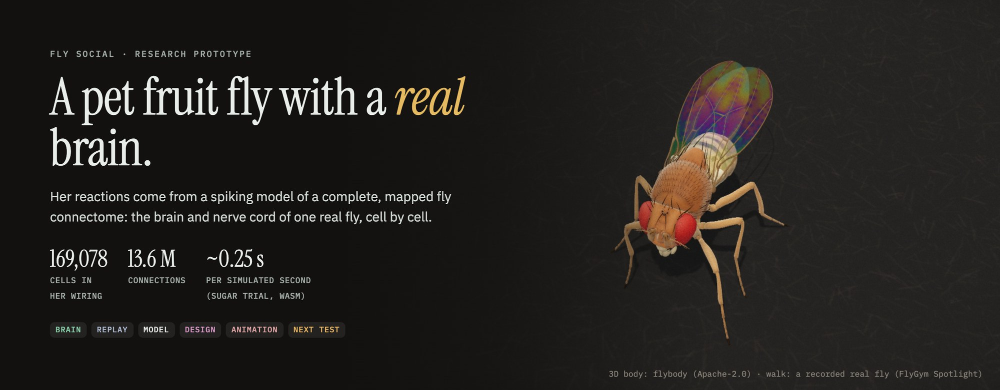

*Banner designed from a real capture: her 3D body is the flybody fruit-fly model, walking with the recorded leg motion of a real fly.*

A research prototype in which every reaction of a pet fruit fly comes from a spiking model of a complete, mapped fly connectome: BANC, the brain and nerve cord of one real fly, with **169,078 cells** and **13.6 million connections** in its wiring. I re-implemented the published whole-brain model (Shiu et al., *Nature* 2024), cross-checked it against the original on FlyWire's sugar pathway (r = 0.999, the pathway cross-checked so far), and ported its kernel to one dependency-free C file that runs bit-identically in WebAssembly. On a fast desktop, one simulated second of a sugar trial takes about a quarter of a second of compute.

Every claim is tested before it reaches the screen. Each behaviour is measured over many fresh trials, most key results are re-run by a separate skeptic pass, and every element on screen is labelled BRAIN, REPLAY, MODEL, DESIGN, ANIMATION or NEXT TEST. The results are presented as predictions about wiring, never as findings about real flies.

<table><tr>
<td width="50%">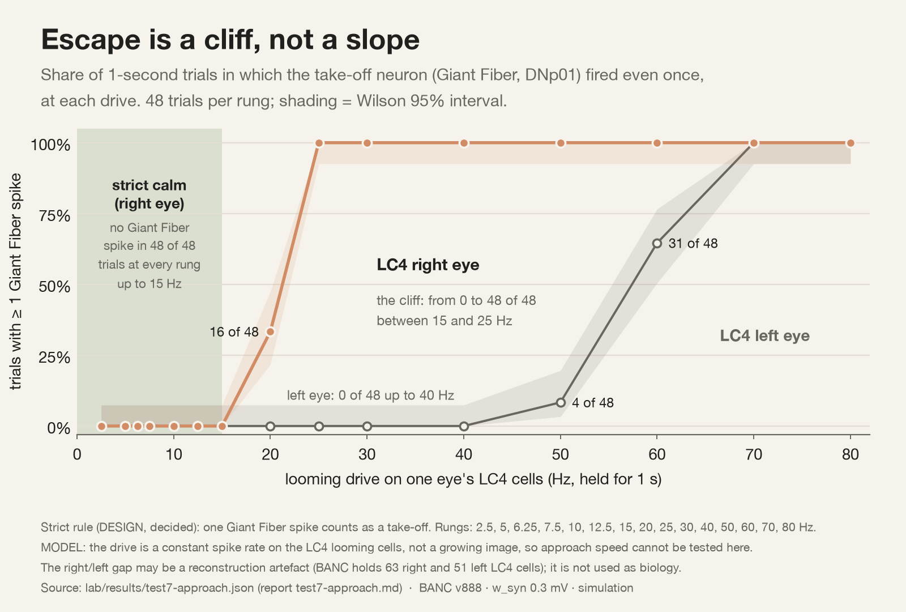</td>
<td width="50%">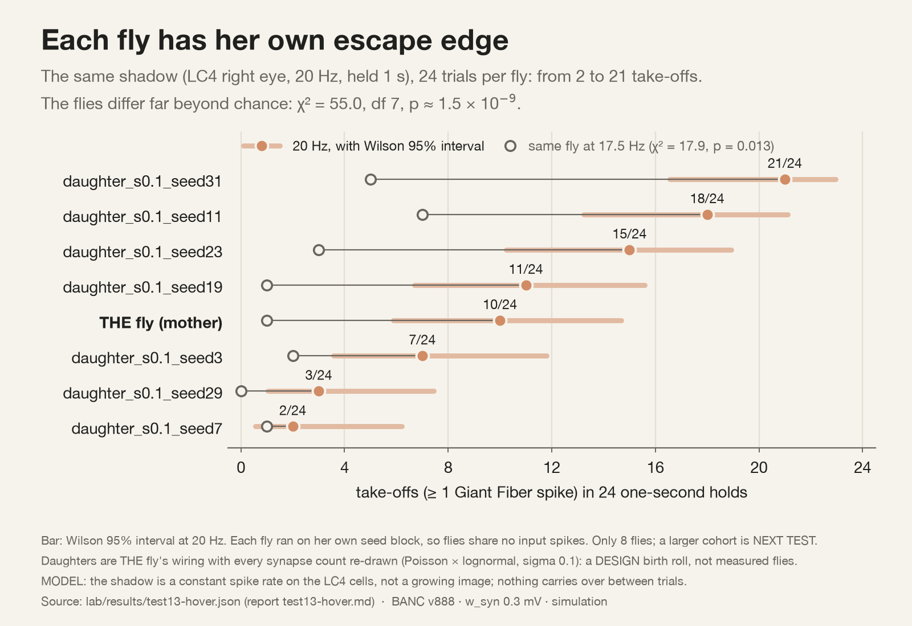</td>
</tr><tr>
<td valign="top"><b>Escape is a cliff, not a slope.</b> In the model, her take-off neuron stays silent up to a threshold of looming drive, then fires in every trial.</td>
<td valign="top"><b>Every sister is her own fly.</b> At the same shadow, eight simulated flies took off from 2 to 21 times in 24 (p ≈ 1.5 × 10⁻⁹): in the model, how jumpy she is lives in her wiring.</td>
</tr></table>

Inside her brain: one sugar drop, and which side she sees a threat on

<table><tr>
<td width="44%">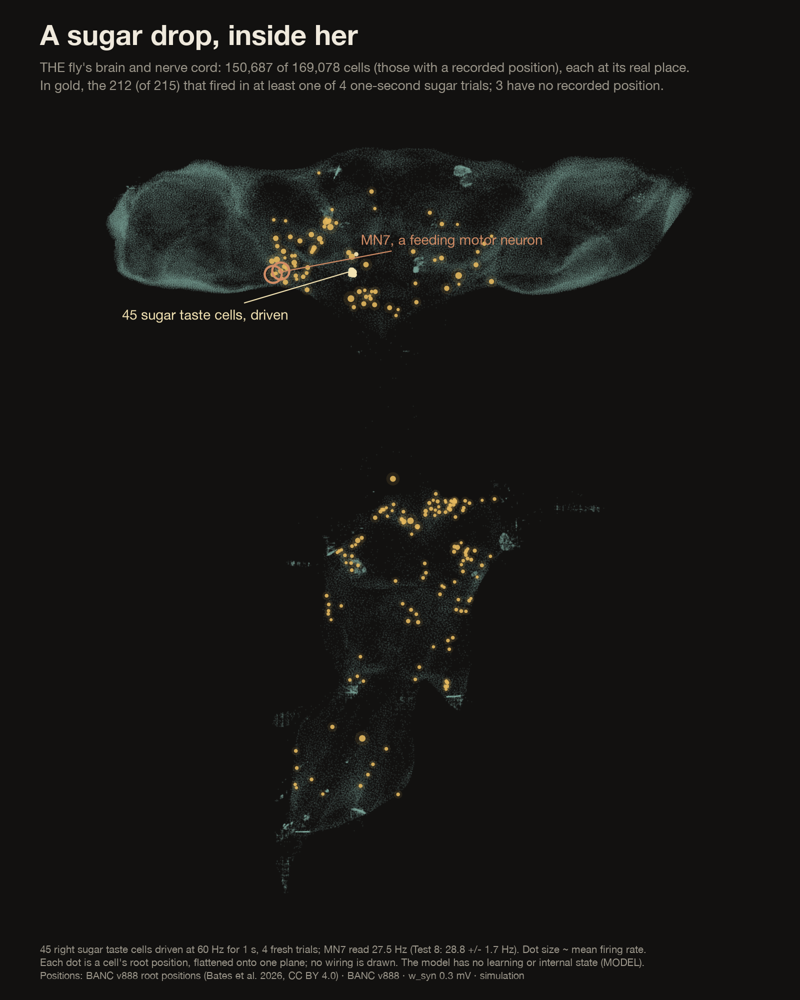</td>
<td valign="top">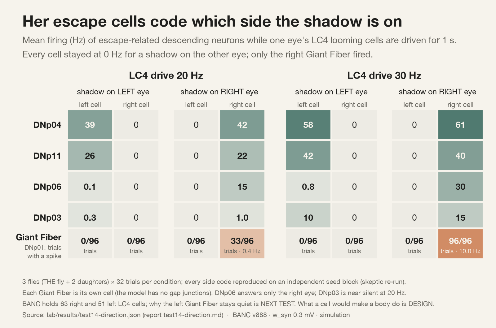  <b>Left:</b> 150,687 cells at their real positions; the ones that fired during four one-second sugar trials glow gold. <b>Above:</b> in the model, a shadow on one eye fires escape-related neurons only on that side.</td>
</tr></table>

*Figures drawn from the project's committed lab results and one live run of its engine (BANC v888, simulation).*

See the prototype: Perch, the 3D fly and the brain lab

<table><tr>
<td width="33%">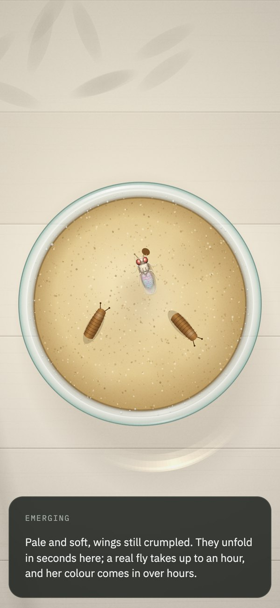</td>
<td width="33%">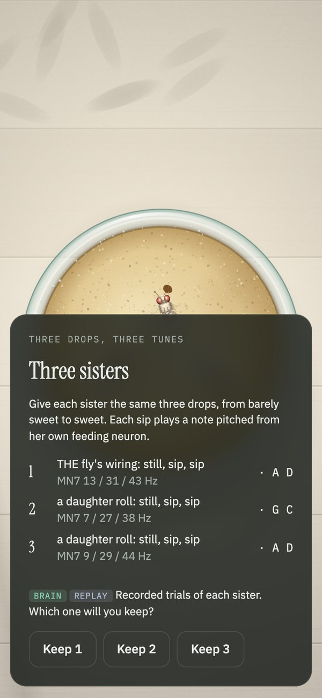</td>
<td width="33%">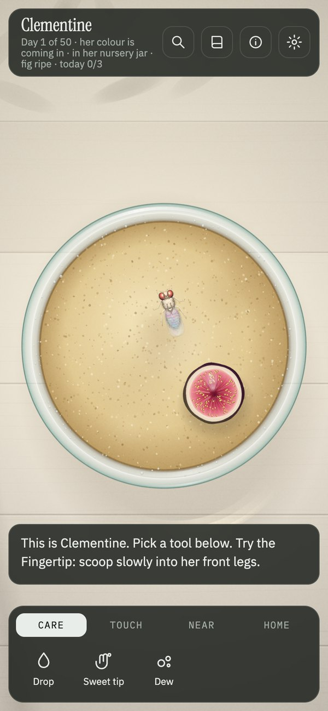</td>
</tr></table>

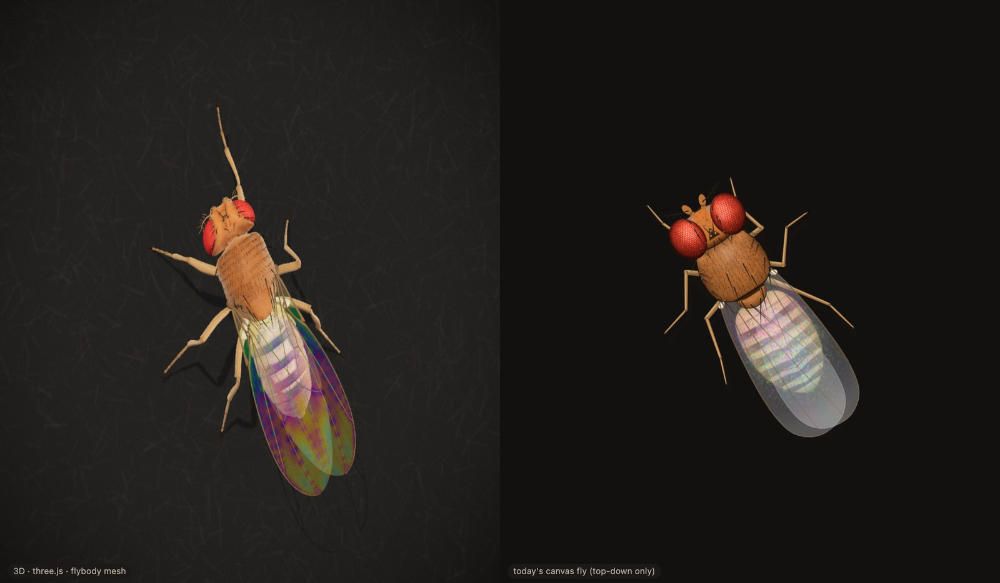

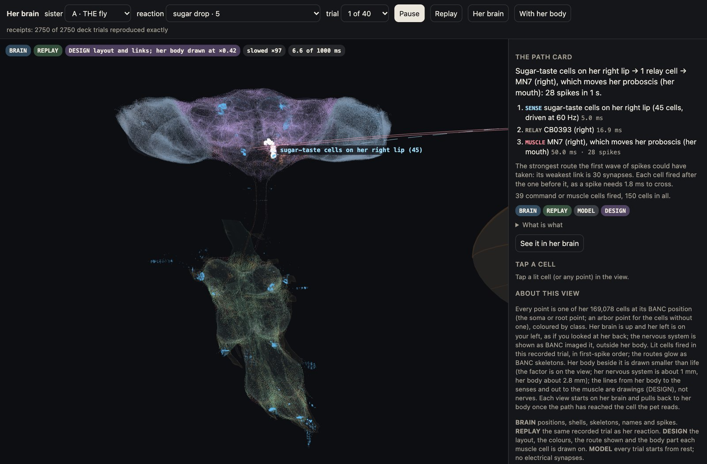

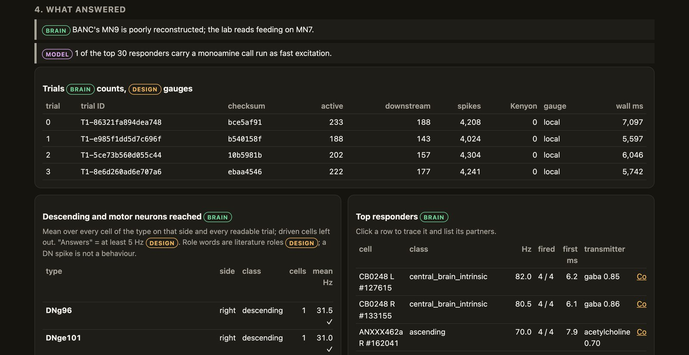

*Actual captures of the working web prototype, the 3D proof page, the 3D brain view with its path card, and the brain lab running the whole connectome live in the browser.*

Concept designs: where it is going

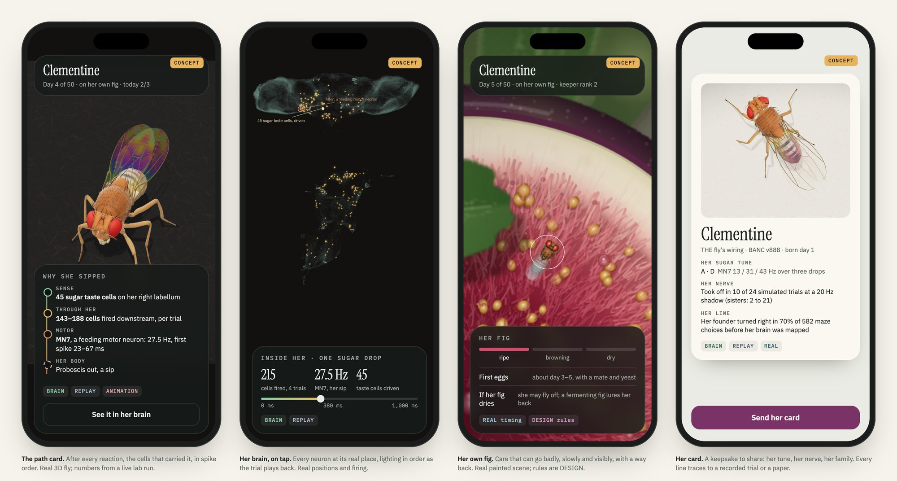

*Concept designs, not working screens. Each is assembled from real renders and lab numbers, and shows a direction from the project's decision log.*

**Demonstrates:** computational neuroscience, scientific software engineering across Python, C and WebAssembly, reproducible experiment design with adversarial re-checks, data visualisation, and honest product design built on research.

`Python` · `numba` · `C` · `WebAssembly` · `three.js` · `matplotlib`

*A research prototype, not a product. The open-source repository is in review before it goes public.*

## Featured work

### [ScoreVest](https://ege-guney-project-showcase.cprkdtnm4v.chatgpt.site/#scorevest) — evidence-first market research

Inspect the original iOS captures

<table><tr><td></td><td></td></tr><tr><td>Market briefing</td><td>Ticker evidence and uncertainty</td></tr></table>

*Actual iOS development captures from an earlier working research build. Home uses demo fixtures; market figures are sample development data.*

A native iOS research platform that brings public discussion, source quality, ticker context, and portfolio information together. Its research views expose attribution, freshness, confidence drivers, and evidence gaps so the reasoning behind a market narrative stays inspectable.

The private codebase also includes a separate deterministic paper-manager engine with ordered risk checks, an append-only ledger, and decision receipts. Optional language-model narration explains recorded facts; it has no authority over trades or the ledger. The public showcase presents the product and engineering approach. ScoreVest remains in active development, with no investment-performance claim.

**Demonstrates:** full-stack product engineering, research-data architecture, analytical reasoning, and reproducible decision systems.

`Java 21` · `Spring Boot` · `PostgreSQL` · `SwiftUI` · `OpenAPI`

### [DIANA](https://ege-guney-project-showcase.cprkdtnm4v.chatgpt.site/diana/) — a foundation for supervised AI work

*Captured from the interactive public demo with fictional Meridian examples.*

An AI workspace interface prototype exploring how governance, visible system state, and review controls can make AI-assisted work easier to understand and supervise. Its current showcase focuses on the interface and trust foundation.

**Demonstrates:** product thinking, interface design, and the translation of AI governance concepts into a usable experience.

### SpectateAI — inspectable agent behaviour

*Future visual concept showing the intended art direction. The playable prototype linked below uses its current graphics.*

See the working gameplay prototype

**[Spectate: current simulation](https://ege-guney-project-showcase.cprkdtnm4v.chatgpt.site/spectate/)** is a Godot prototype following **12 villagers** whose needs, beliefs, resource scarcity, and rumours shape their decisions. Its deterministic, utility-based engine makes behaviour inspectable and runs reproducible, providing an interactive way to explore how individual rules produce group outcomes.

**[SpectateAI: project overview](https://ege-guney-project-showcase.cprkdtnm4v.chatgpt.site/#spectateai)** extends that direction toward a richer AI game. Language-model features are planned; the implemented simulation uses utility-based decision rules.

**Demonstrates:** agent-system design, simulation mechanics, state modelling, and interactive explanation through deterministic decision rules.

## How I work

I use AI coding tools to accelerate implementation while retaining responsibility for requirements, architecture, code review, and verification. I value clear contracts, observable behaviour, and documentation that lets the next person understand both the result and its limits.

**Core tools:** Java, Spring Boot, PostgreSQL, SwiftUI, Godot, Git, Docker, and AI-assisted development with Claude Code and Codex.

[Project showcase](https://ege-guney-project-showcase.cprkdtnm4v.chatgpt.site/) · [Privacy](https://ege-guney-project-showcase.cprkdtnm4v.chatgpt.site/privacy/) · [LinkedIn](https://www.linkedin.com/in/egeguney) · [GitHub](https://github.com/Ege-Guney)

## Optional concept previews

ScoreVest and DIANA show their working interfaces above; the additional concepts below explore possible future directions. SpectateAI features its preferred concept artwork with gameplay captures available underneath.

Future ScoreVest design direction

*AI-generated concept. Illustrative data and proposed interface; not a working app capture.*

Future DIANA design direction

*AI-generated concept. Fictional workflow and proposed interface; not a working app capture.*

